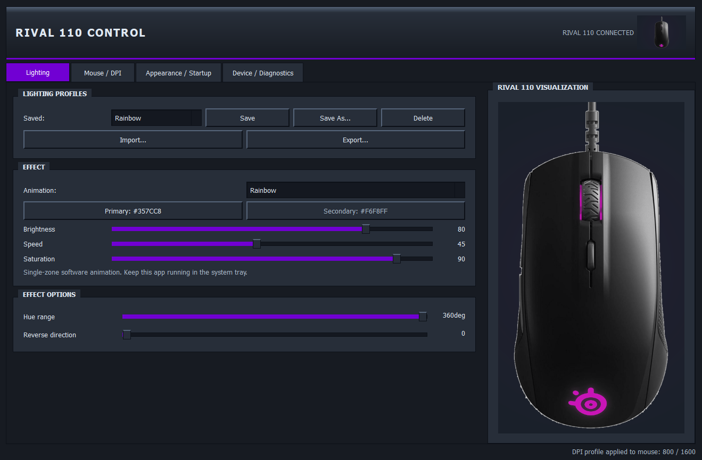
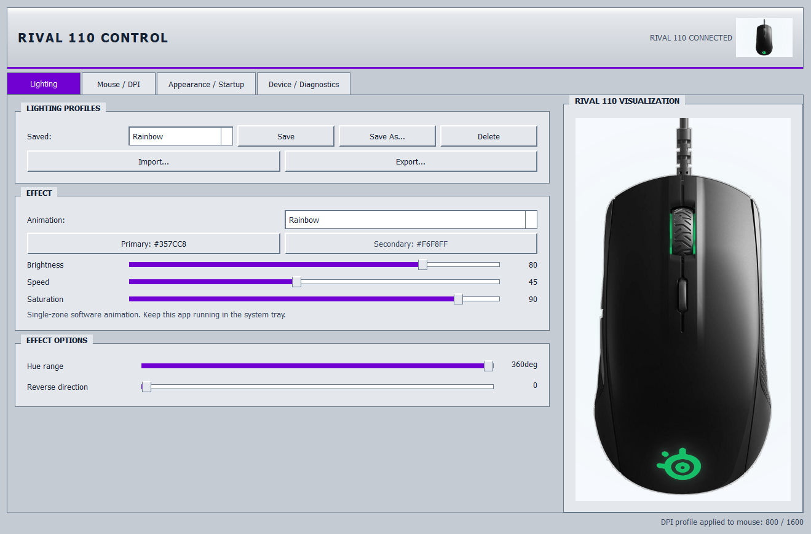
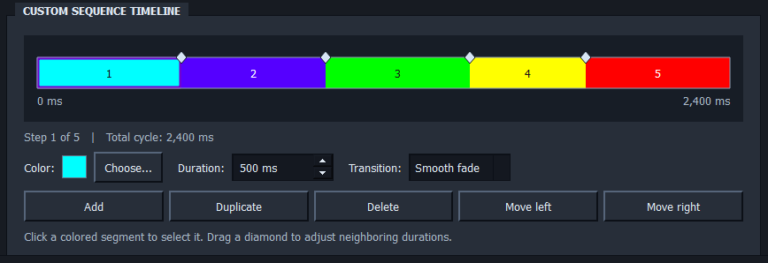

# Rival 110 Lite Control

A lightweight, open-source Windows control panel for the **SteelSeries Rival 110**. Configure DPI and polling rate, create RGB animations, manage profiles, and control your mouse from the system tray — **without SteelSeries GG**.

**[Download the latest Windows release](https://github.com/Dumpflam/Rival-110-Lite-Control/releases/latest)** · [Build from source](#build-from-source) · [Original project](https://github.com/AnonBOTpl/Rival-Lite-Control)

## Screenshots

### Dark theme



### Light theme



### Custom Sequence editor



> **AI use and attribution:** This rebuild was created using ChatGPT. I do not claim credit for the original [Rival Lite Control](https://github.com/AnonBOTpl/Rival-Lite-Control) project by AnonBOTpl or for [Rivalcfg](https://github.com/flozz/rivalcfg), which provides mouse-control functionality. This is an unofficial community project and is not affiliated with SteelSeries.

## Download and run

1. Open the [latest release](https://github.com/Dumpflam/Rival-110-Lite-Control/releases/latest).
2. Download the Windows `.exe` from **Assets**.
3. Launch the application with your Rival 110 connected.

**You don't need Python or SteelSeries GG to run the standalone EXE.** Since the executable is unsigned, Windows SmartScreen may display a warning. Only run software you trust.

If your mouse isn't detected, fully exit SteelSeries GG / Engine or other software that may have control of the device, then try **Device / Diagnostics → Reconnect Rival 110**.

## Compatibility

| | |
|---|---|
| **Mouse** | SteelSeries Rival 110 (`USB 1038:1729`) |
| **OS** | Windows 10 / Windows 11 |
| **Standalone EXE** | No separate Python installation required |
| **Building from source** | Python 3.10+ and an internet connection |

This interface is designed for the Rival 110. Other SteelSeries models are not supported.

## Features

### DPI and mouse settings

- Two onboard DPI stages, adjustable from **200 to 7,200 DPI** in 100-DPI steps
- Polling rates: **125 / 250 / 500 / 1,000 Hz**
- DPI button behavior: cycle DPI stages or use OS-defined input
- Named DPI profiles with immediate switching from the system tray
- Profile import/export and device settings saved to the mouse
- Optional device reset with confirmation

### RGB lighting

The Rival 110 has **one controllable RGB lighting zone**. Effects generate a single color at any given moment rather than imitating multiple independent LED zones.

**16 software lighting effects:**

| | | | |
|---|---|---|---|
| Static | Two-color | Off | Rainbow |
| Breathing | Two-color Pulse | Custom Gradient | Sunrise |
| Comet | Lightning | Color Wave | Fire |
| Ocean | Starry Night | CPU Monitor | Custom Sequence |

Effects offer brightness, saturation, speed where appropriate, and additional effect-specific controls.

**Custom Sequence** uses a visual, color-coded timeline instead of a table. Select a keyframe to edit its color, duration, and transition; drag the diamond separators to redistribute neighboring durations; and add, duplicate, delete, or reorder steps. Sequences support up to **100 steps** with durations of **50–60,000 ms** per step.

Software animations require the app to remain running, but it can stay minimized to the system tray. Supported static and onboard hardware lighting modes can be saved to the mouse; hardware modes include Breath and firmware effects 2 and 4. Their precise firmware-defined visual behavior is not documented here.

### Live mouse preview

- Large Rival 110 visualization with a smaller preview on narrow windows
- Pixel-aligned lighting on the **actual scroll wheel and logo shapes** in the reference photo
- Dark and light themes with natural-looking mouse reflections
- Lighting preview updates with the selected effect

### Windows interface and system tray

- Classic, square-edged Windows-inspired UI with selectable accent colors
- Dark theme by default; optional light theme
- Saved DPI and lighting profiles available from the system tray
- Change lighting effects without reopening the main window
- Optional **Start with Windows**, enabled by default; automatic launches open to the tray
- Closing the window minimizes to the tray by default; choose **Exit** from the tray menu to quit
- Single-instance behavior: launching the app again opens the existing instance
- Automatic attempts to reconnect after USB disconnection

## Build from source

### Build on Windows

1. Clone the repository or select **Code → Download ZIP**, then extract it.
2. Install [Python 3.10 or newer](https://www.python.org/downloads/), with `py` or `python` available on `PATH`.
3. Run **`BUILD_EXE.bat`** from the project root.
4. The builder creates an isolated environment, installs dependencies, runs tests (including the Windows Qt GUI/tray smoke test), and packages the program with PyInstaller.
5. When the build finishes successfully, find **`Rival110LiteControl.exe`** next to the build script.

The executable bundles its Python runtime and required assets, so it can be moved to another Windows PC without a separate Python installation.

### Build using GitHub Actions

You can also use the repository's [Actions tab](https://github.com/Dumpflam/Rival-110-Lite-Control/actions) to run the Windows build workflow, then download its executable artifact from the completed workflow run. This is useful if you don't want to set up a local Python build environment.

## Using the application

**Mouse / DPI:** Set both DPI stages, polling rate, and DPI button behavior, then apply and save settings to the mouse. Create named profiles for quick switching.

**Lighting:** Pick an effect, customize it, and save a lighting profile. Keep the app in the tray for software-driven animation.

**Device / Diagnostics:** Reconnect the mouse, access supported onboard save controls, or inspect device status.

**Appearance / Startup:** Choose your theme, accent color, and Windows startup behavior.

## Profiles and settings

Configuration and logs are stored separately from the executable:

```text
%APPDATA%\Rival110Lite\settings.json
%APPDATA%\Rival110Lite\rival110.log
```

Profiles use JSON and can be imported or exported. The app attempts to import legacy `.rivalprofile` files by translating recognized effect names and using the original first-zone color. Previous settings are backed up automatically.

If you move the EXE after enabling autostart, disable and re-enable **Start with Windows** so the stored launch path is updated.

## Limitations and testing

- The r17 source passed **32 offline Python tests** covering lighting, settings, mocked device commands, and regression checks.
- The Windows build script runs a Qt GUI/tray integration test before packaging. Automated tests do not replace validation on a physical Rival 110.
- Actual USB behavior can vary with firmware, drivers, and competing software. Hardware configurations have not been exhaustively tested.
- Sensor calibration, lift-off-distance adjustment, macros, and other features absent from Rivalcfg's Rival 110 interface are not offered. No speculative HID commands are sent.
- The distributed executable is unsigned and may trigger Windows SmartScreen.
- PyInstaller's one-file format may make initial startup slower while bundled files are extracted.

## Credits and license

- [Rival Lite Control](https://github.com/AnonBOTpl/Rival-Lite-Control) by **AnonBOTpl** — original project and inspiration (MIT)
- [Rivalcfg](https://github.com/flozz/rivalcfg) by **flozz and contributors** — underlying SteelSeries device-control library ([Rival 110 reference](https://flozz.github.io/rivalcfg/devices/rival110.html))
- **ChatGPT** — used to create the rebuilt source code, interface, image processing, tests, and documentation

This rebuild is provided under the **MIT License**; see [LICENSE](LICENSE). Dependencies and upstream projects retain their respective licenses and attribution requirements.
